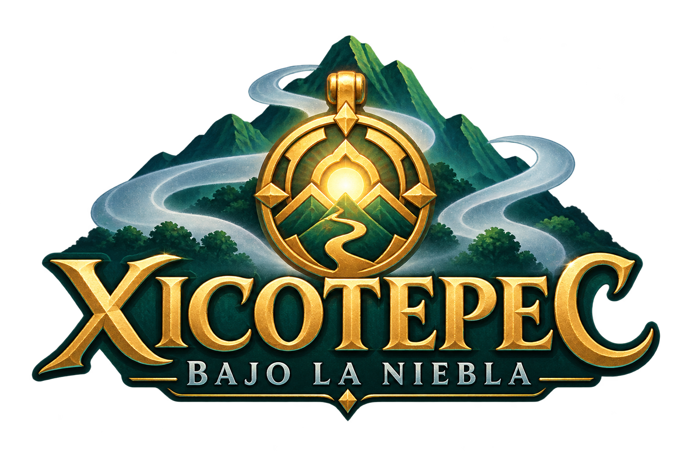
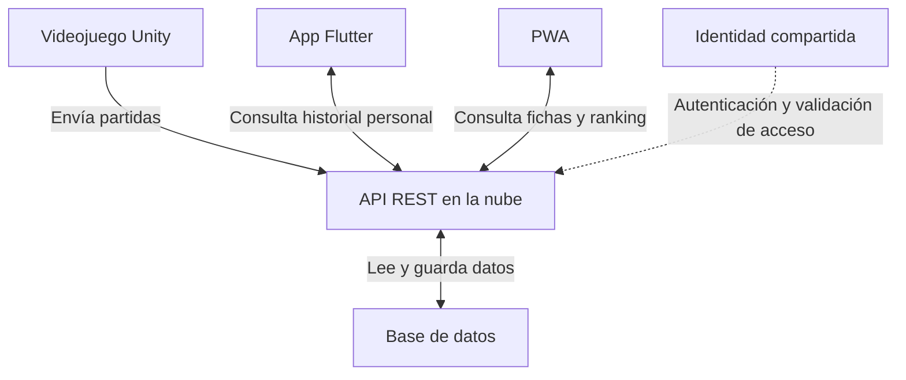
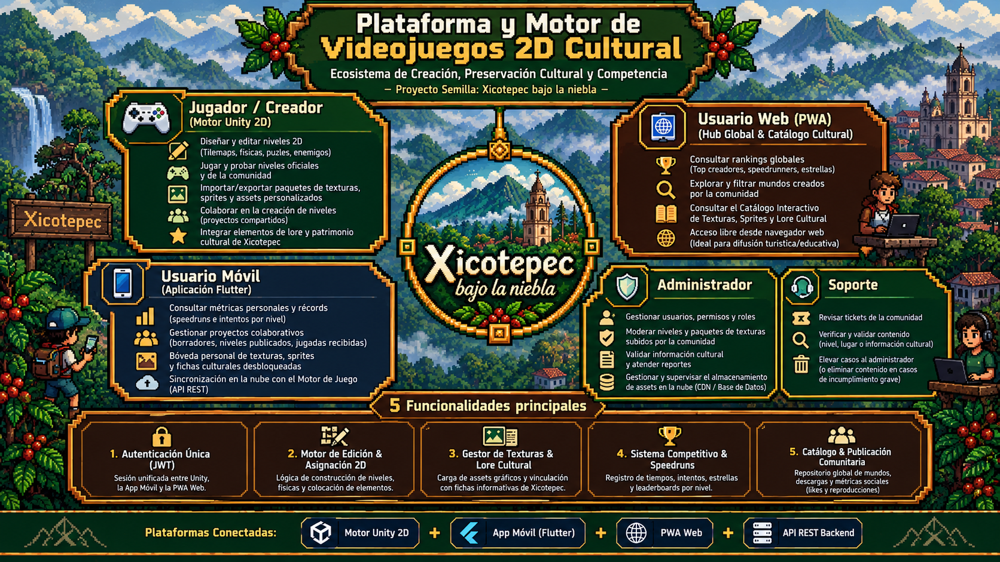

<div align="center">




# Xicotepec bajo la niebla

**Una aventura de acción y plataformas para descubrir Xicotepec a través del juego.**

Videojuego 2D · PWA cultural · Aplicación móvil · API en la nube


### Videojuego


### Aplicaciones e integración


### Trabajo en equipo


**Universidad Tecnológica de Xicotepec de Juárez**  
Ingeniería en Desarrollo y Gestión de Software · Décimo cuatrimestre

</div>

## Diagrama de secuencia
[Diagrama de secuencia](./DiagramaDeSecuencia/)

## Modelo Canvas
[Link en git Pages](https://heidrihen52.github.io/Xicotepec_bajo_la_niebla/BusinessModelCanva/)

## Manual de instalacion
[Manual de Instalación](/ManualDeInstalacion/)
---

## Acerca del proyecto

**Xicotepec bajo la niebla** es un videojuego de acción y plataformas en 2D ambientado en una versión ficticia de Xicotepec de Juárez. Tres estudiantes —**Balam, Rayo y Kiro**— combinan fuerza, agilidad y tecnología para resolver puzles ambientales, enfrentar fauna alterada y avanzar por una región cubierta de niebla mística.

El proyecto conecta la aventura con dos aplicaciones complementarias: una **PWA** para consultar información cultural y rankings, y una **app en Flutter** para revisar el historial y las estadísticas personales. Una API REST y una base de datos en la nube permiten compartir la información de una misma cuenta.

El núcleo del desarrollo es **UTXJ Tutorial**, una sección jugable que reúne las mecánicas principales y permite comprobar la experiencia antes de ampliar la campaña.

## Problemática

El proyecto parte de una pregunta: **¿cómo despertar el interés de los jóvenes por los lugares y la cultura de Xicotepec mediante una experiencia interactiva?**

Conocer el nombre de un lugar no implica conocer su contexto. Queremos explorar si una aventura acompañada de fichas breves puede motivar al jugador a investigar más sobre los espacios que inspiran los escenarios. La PWA permite acceder a ese contenido también a quienes no tengan instalado el juego.

Este planteamiento se evaluará con investigación de contenido y participación de usuarios; no se presenta como un diagnóstico demostrado de desconocimiento cultural en la población.

## Objetivo general

Desarrollar un videojuego 2D ambientado en Xicotepec, integrado con una PWA y una aplicación móvil mediante una API en la nube, que combine exploración, combate y consulta de contenido cultural, y permita al jugador dar seguimiento a sus partidas y progreso.

## Objetivos específicos

- Construir el tutorial UTXJ con obstáculos y combates que hagan necesarias las habilidades de los tres protagonistas.
- Implementar salud y estamina compartidas, puntos de control, cambio de personaje y habilidades Ultimate.
- Preparar fichas de los lugares que inspiran el juego, con fuentes identificables y una separación clara entre información real y ficción.
- Registrar partidas con un ID único, puntuación, tiempo efectivo, derrotas y métricas de uso de personajes.
- Sincronizar los registros con la nube, conservando partidas pendientes cuando no haya conexión y evitando duplicados.
- Mostrar información cultural y rankings en la PWA, y estadísticas personales e historial en Flutter.
- Evaluar la jugabilidad, la integración y la claridad del contenido mediante pruebas y comentarios de usuarios.

## Historia y ambientación

Un hechicero desterrado cubre Xicotepec con una niebla oscura para absorber la energía mística de La Xochipila. Su magia altera la fauna y convierte los caminos en una serie de peligros y obstáculos.

Balam, Rayo y Kiro comienzan su aventura en la universidad. El recorrido completo contempla el centro de Xicotepec, el ascenso hacia la Cruz Celestial y el enfrentamiento final en La Xochipila.

**La historia es ficticia.** Los escenarios son adaptaciones para el juego; los personajes, la magia y los sucesos no describen prácticas culturales reales. Las fichas informativas tendrán un tratamiento separado y contenido investigado.

## Protagonistas y mecánicas


| Personaje | Rol | Ataque y utilidad | Ultimate |
| :--- | :--- | :--- | :--- |
| **Balam** | Tanque y fuerza | Combate cuerpo a cuerpo, Ground Slam para destruir escombros y golpe superior contra enemigos voladores bajos. | **Earthquake Slam:** onda expansiva que despeja el área y destruye los escombros visibles. |
| **Rayo** | Agilidad y daño a distancia | Doble salto y resortera con apuntado horizontal, vertical y diagonal. | **Lightning Barrage / Time Overdrive:** ráfaga de proyectiles perforantes a cámara lenta, sin consumo de estamina durante la habilidad. |
| **Kiro** | Soporte, control y tecnología | Dron EMP que busca objetivos, aplica aturdimiento de **2.5 segundos** y aumenta **50 %** el daño recibido; activación remota de paneles. | **EMP Overcharge:** aturdimiento y vulnerabilidad para enemigos en pantalla, y activación de paneles del cuarto. |

La salud y la estamina son globales. Los tres personajes comparten la barra **UltimateGauge**, utilizada para activar la habilidad especial del personaje activo. Los valores de balance podrán ajustarse conforme se prueben las mecánicas.

### Controles principales

| Acción | Control |
| :--- | :---: |
| Movimiento | A / D o flechas |
| Salto | Espacio |
| Ataque base del personaje activo | J |
| Interacción o activación de paneles | E |
| Balam / Rayo / Kiro | 1 / 2 / 3 |
| Ultimate del personaje activo | R |
| Pausa | Esc |

Los controles se documentarán junto con cualquier cambio en la implementación.

## Plataformas y arquitectura

| Componente | Propósito | Tecnologías |
| :--- | :--- | :--- |
| **Videojuego** | Explorar, combatir, resolver obstáculos y registrar partidas. | Unity 2D, C# y URP 2D. |
| **PWA** | Consultar fichas culturales y rankings globales por alias y puntuación. | React y tecnologías web para PWA. |
| **App móvil** | Consultar historial, métricas por personaje y estadísticas de la cuenta. | Flutter y Dart. |
| **API** | Validar identidad y datos, recibir partidas y proporcionar consultas. | Node.js, Express, REST y JSON. |
| **Base de datos** | Almacenar usuarios asociados a su identidad, partidas y estadísticas. | PostgreSQL en la nube. |




Las aplicaciones se comunican con la API mediante **HTTPS**. Flutter y PWA consultan el servidor de forma independiente; no necesitan comunicarse directamente entre sí ni acceder a la base de datos.

### Flujo de estadísticas

1. Unity finaliza una partida y genera un registro con ID único.
2. El registro se guarda localmente antes de enviarse.
3. La API valida la identidad, comprueba los datos y guarda la partida.
4. Si falla la conexión, Unity conserva el registro y reintenta con el mismo ID.
5. Flutter consulta el historial personal y la PWA consulta los resultados públicos.


## Alcance del tutorial

El tutorial se organiza en cuatro zonas con dificultad progresiva:

| Zona | Enfoque | Experiencia prevista |
| :---: | :--- | :--- |
| **1** | Balam y escombros | Destrucción de obstáculos con Ground Slam y combate cuerpo a cuerpo. |
| **2** | Rayo y plataformas | Saltos horizontales y verticales; combate aéreo con resortera direccional. |
| **3** | Kiro y control EMP | Activación de paneles e inmovilización de enemigos para combinar ataques. |
| **4** | Punto de control y cierre | Restauración de estado, combate integrador y transición de nivel. |

La campaña contempla también **Centro de Xicotepec, Cruz Celestial y La Xochipila**. La prioridad actual es consolidar el tutorial y su integración. El multijugador, la monetización y un sistema avanzado contra trampas quedan fuera de esta primera entrega.

## Organización del código Unity

La organización definida en el documento técnico separa las responsabilidades dentro de `Assets/Scripts/`:

```text
Assets/Scripts/
├── Player/
│   ├── PlayerController.cs
│   ├── PlayerCombat.cs
│   ├── BalamAbilities.cs
│   ├── RayoController.cs
│   ├── KiroAbilities.cs
│   ├── SlingshotProjectile.cs
│   └── DroneProjectile.cs
├── Enemies/
│   ├── EnemyAI.cs
│   └── EnemyHealth.cs
├── Environment/
│   ├── CheckpointManager.cs
│   ├── Checkpoint.cs
│   ├── ElectronicPanel.cs
│   ├── CameraController.cs
│   ├── RoomTrigger.cs
│   ├── ParallaxEffect.cs
│   └── ImpactEffect.cs
├── Interfaces/
└── Settings/
```

`PlayerStats.cs` centraliza las estadísticas globales y `PlayerUI.cs` representa el HUD. El documento agrupa estos componentes bajo `Interfaces/` y `Settings/`; su ubicación exacta se documentará conforme a la organización del repositorio.

## Estado y hoja de ruta

El plan general considera **12 semanas**. La siguiente etapa se concentra en las cuatro zonas del tutorial y la **Fase 5 de pulido visual y audio**.

| Etapa | Trabajo principal |
| :--- | :--- |
| Base del juego | Mecánicas, personajes, estadísticas, enemigos, cámara y parallax reportados en V2. |
| Tutorial | Estructuración y prueba de las cuatro zonas. |
| Pulido visual | Luces URP 2D, partículas, impacto, Hit Flash, Dissolve y Glow de paneles. |
| Audio | Incorporación y ajuste de efectos sonoros. |
| Integración | Cuenta compartida, API, sincronización, PWA y app Flutter. |
| Validación | Pruebas de juego, datos, permisos y revisión de contenido cultural. |

La integración web, móvil y de nube forma parte de las siguientes entregas; su avance se registrará por componente.


## Pruebas y criterios de entrega

La validación contempla:

- **Jugabilidad:** movimiento, cambio de personaje, combate terrestre y aéreo, puzles y Ultimates.
- **Estado del juego:** salud y estamina compartidas, pausa, derrota y restauración desde puntos de control.
- **Integración:** envío de partidas, autenticación, reintentos y prevención de duplicados.
- **Aplicaciones:** coherencia entre estadísticas personales y ranking público.
- **Contenido:** fuentes identificables, claridad de las fichas y distinción entre realidad y ficción.

Los casos de prueba iniciales deberán actualizarse al balance, especialmente para el dron EMP, la resortera direccional y las habilidades Ultimate. Los resultados, versiones y evidencias se registrarán antes de declarar lista una entrega.

## Diagrama de Roles




## Equipo

| Integrante | Áreas de trabajo propuestas |
| :--- | :--- |
| **Jesús Domínguez Ramírez** | Programación de mecánicas, API e integración, Diseño de niveles. |
| **Adrián Pérez Jiménez** | Interfaces y experiencia de usuario. |
| **Luis Daniel Suárez Escamilla** | Pruebas, contenido cultural. |
| **Sayurid Bautista Cruz** | Documentación, Arte. |
| **Jonathan Emmanuel Lopez Morales** | Documentación y apoyo en la aplicación móvil. |

El proyecto se desarrolla en equipo. Las asignaciones pueden ajustarse según las necesidades y el avance de cada componente.

## Desarrollo local

Para trabajar con el videojuego, se requiere **Unity Hub** y la versión de Unity que corresponda al proyecto. La referencia de versión será `ProjectSettings/ProjectVersion.txt`; los paquetes se gestionan mediante el manifiesto del proyecto.

La app móvil requiere Flutter, Dart y un dispositivo o emulador compatible. La PWA y la API requieren el entorno Node.js y sus dependencias; PostgreSQL será necesario para la persistencia de datos durante la integración.

Los comandos de instalación, rutas de los componentes y variables de entorno se documentarán cuando estén incorporados al repositorio.

